<a href="https://github.com/gallowforge/vesper/releases/latest#gh-dark-mode-only"><picture><source media="(max-width: 767px)" srcset="docs/readme/hero-dark-phone.webp 2.835x"><source srcset="docs/readme/hero-dark.webp 2x">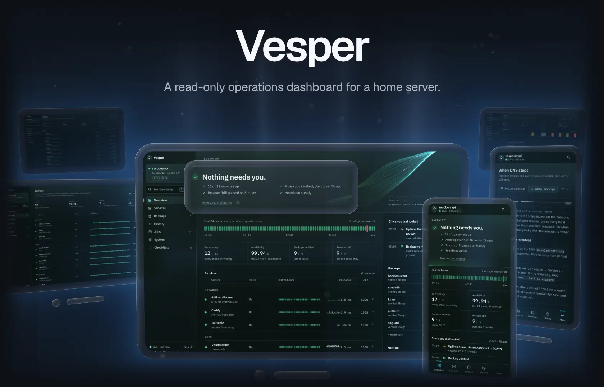</picture></a><a href="https://github.com/gallowforge/vesper/releases/latest#gh-light-mode-only"><picture><source media="(max-width: 767px)" srcset="docs/readme/hero-light-phone.webp 2.835x"><source srcset="docs/readme/hero-light.webp 2x"></picture></a>

A well-run homelab already knows a lot about itself: the backup job records what it verified, a weekly drill restores the archives, a notifier remembers every alert, and a repo says what every config file should contain. Vesper reads all of it, adds live service health seen from the client's side, and answers one question on a phone or a desktop: does anything need you? If nothing does, it says so and shows what it checked. If something does, it names it, worst first, with the checklist that covers it. If it cannot see something, it says that too, instead of guessing. It only reads, and it is one binary with the UI inside.

<p align="center"><a href="#quickstart"><b>Quickstart</b></a> &nbsp;·&nbsp; <a href="#how-it-works">How it works</a> &nbsp;·&nbsp; <a href="https://github.com/gallowforge/vesper/releases">Releases</a></p>

<a href="docs/configuration.md#gh-dark-mode-only"><picture><source media="(max-width: 767px)" srcset="docs/readme/numbers-dark-phone.webp 2.835x"><source srcset="docs/readme/numbers-dark.webp 2x">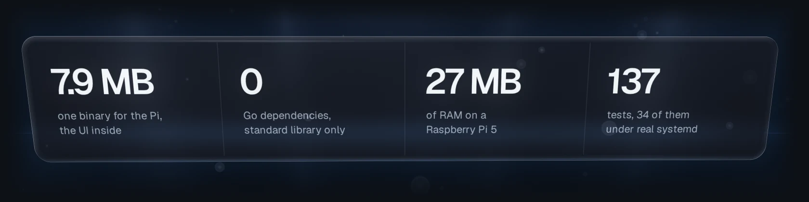</picture></a><a href="docs/configuration.md#gh-light-mode-only"><picture><source media="(max-width: 767px)" srcset="docs/readme/numbers-light-phone.webp 2.835x"><source srcset="docs/readme/numbers-light.webp 2x"></picture></a>

<sub>7.4 MB is the static arm64 binary on the releases page. RAM was measured on a Raspberry Pi 5 watching 22 services, 12 backup sets and 29 timers, at 0.8% of one CPU core. Every screen in these images is the real UI of <code>vesper demo</code> on synthetic data and a frozen clock.</sub>

## Know in one glance if the server is fine

One sentence first: "Nothing needs you", with the checks behind it, or the problem by name, with the button that opens the service and the checklist that covers it. Under it, the last 24 hours of every service in quarter hours, four key figures, every service with its day and its answer time, and what happened since you last looked. New snapshots arrive over Server-Sent Events, so the page is live without a refresh.

<a href="docs/configuration.md#gh-dark-mode-only"><picture><source media="(max-width: 767px)" srcset="docs/readme/overview-dark-phone.webp 2.835x"><source srcset="docs/readme/overview-dark.webp 2x">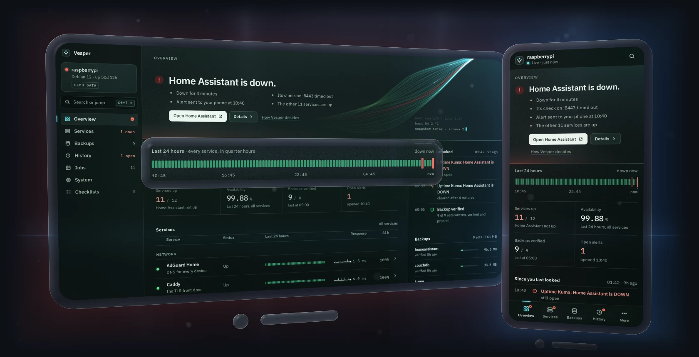</picture></a><a href="docs/configuration.md#gh-light-mode-only"><picture><source media="(max-width: 767px)" srcset="docs/readme/overview-light-phone.webp 2.835x"><source srcset="docs/readme/overview-light.webp 2x">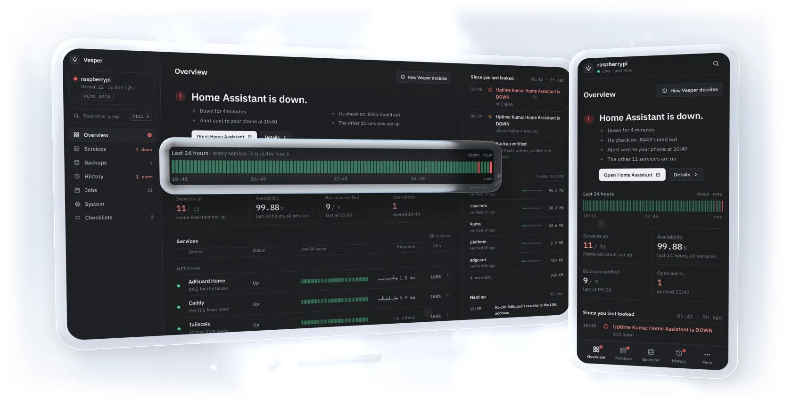</picture></a>

## Every service, seen the way a client sees it

A service joins a Docker container, a systemd unit and a probe that goes through your reverse proxy with the right TLS name, so an expiring certificate or a broken route shows up. Each one keeps a day line in five-minute slots, kept across restarts, so its uptime and outages are counted over the last 24 hours; time Vesper did not watch stays unknown. Its page adds the answer time, the days left on its certificate and its restarts. Press <kbd>Ctrl</kbd> <kbd>K</kbd> and type three letters to land on any service, backup set, alert, job or checklist.

<a href="docs/configuration.md#gh-dark-mode-only"><picture><source media="(max-width: 767px)" srcset="docs/readme/services-dark-phone.webp 2.835x"><source srcset="docs/readme/services-dark.webp 2x">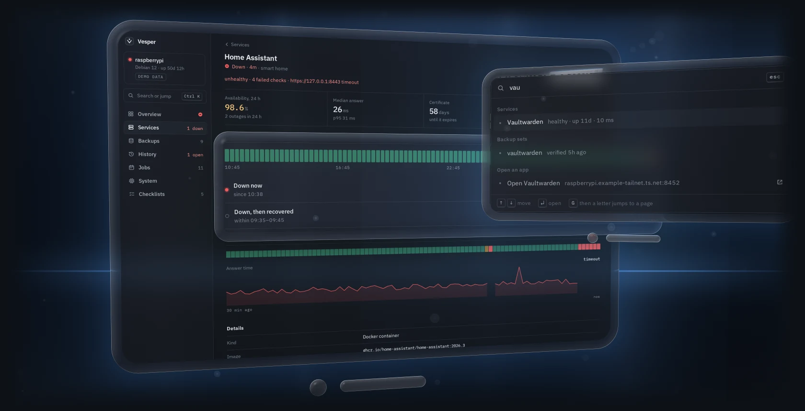</picture></a><a href="docs/configuration.md#gh-light-mode-only"><picture><source media="(max-width: 767px)" srcset="docs/readme/services-light-phone.webp 2.835x"><source srcset="docs/readme/services-light.webp 2x">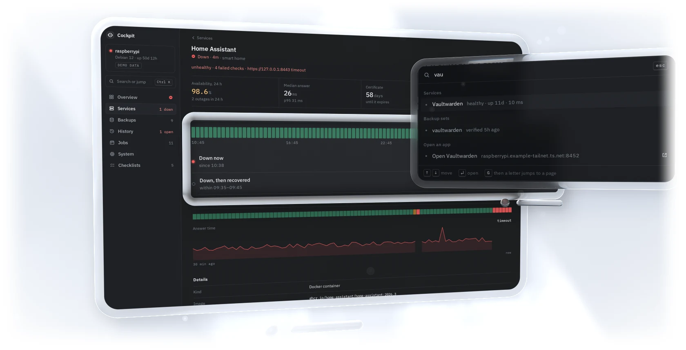</picture></a>

## Backups you can trust, with the proof beside them

Each set shows when it was last verified, its age against its own limit, its size, how much it grew this month and the row counts the backup engine checked. Thirty nights of runs come from the journal, with the line that explains a failed one, and the weekly restore drill's result for every set sits beside them, so you know the archive you would restore from has already been read back.

<a href="https://github.com/gallowforge/homelab#gh-dark-mode-only"><picture><source media="(max-width: 767px)" srcset="docs/readme/backups-dark-phone.webp 2.835x"><source srcset="docs/readme/backups-dark.webp 2x">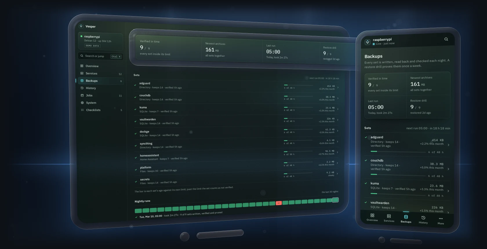</picture></a><a href="https://github.com/gallowforge/homelab#gh-light-mode-only"><picture><source media="(max-width: 767px)" srcset="docs/readme/backups-light-phone.webp 2.835x"><source srcset="docs/readme/backups-light.webp 2x">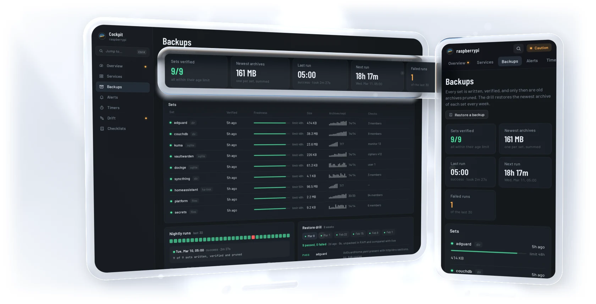</picture></a>

## Everything that happened, on one timeline

Alerts, backup runs, restore drills and failed jobs, newest first. Each push from the notifier is grouped with its repeats and its all-clear, so you read "open for 3 hours" or "all-clear after 4 minutes" instead of a phone full of separate pushes. What is open right now comes from the notifier's own state, so an alert that was never resolved cannot quietly disappear, and 30 days of alerts are charted by severity.

<a href="docs/configuration.md#gh-dark-mode-only"><picture><source media="(max-width: 767px)" srcset="docs/readme/history-dark-phone.webp 2.835x"><source srcset="docs/readme/history-dark.webp 2x">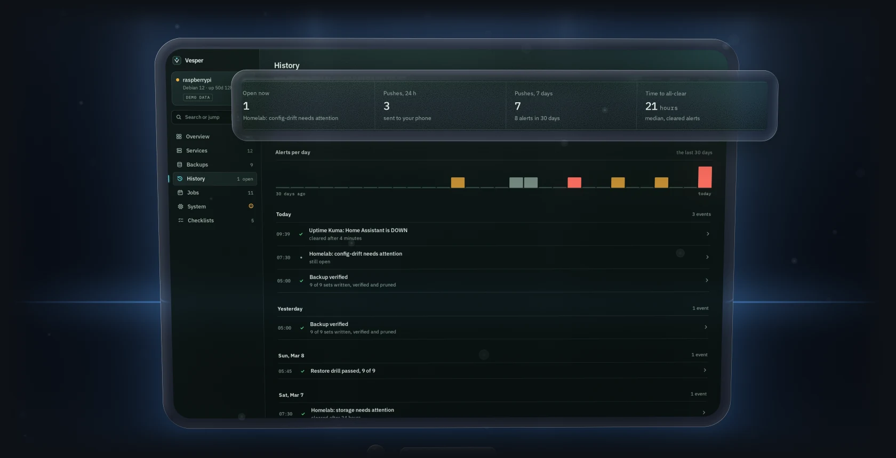</picture></a><a href="docs/configuration.md#gh-light-mode-only"><picture><source media="(max-width: 767px)" srcset="docs/readme/history-light-phone.webp 2.835x"><source srcset="docs/readme/history-light.webp 2x">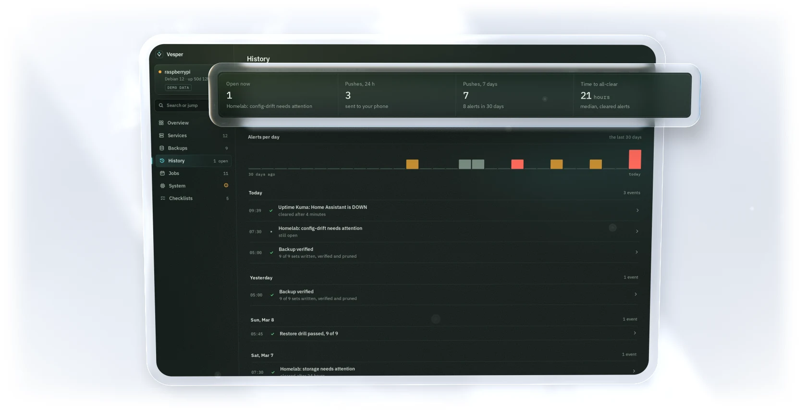</picture></a>

## Honest about what it can't see, in your hand

If a source cannot be read, a service cannot be confirmed, or a check that is set up has never run, Vesper says "Vesper can't see" and shows the error, never "Nothing needs you": an all-clear it cannot prove is not given. Every page works on a phone, and Vesper installs to the home screen as an app. Point it at the Markdown runbooks you already keep and their numbered steps become a checklist you tick through, kept on that device for 12 hours. Sign-in is one username-and-password form that password managers save and fill, checked against a PBKDF2 hash with 600,000 rounds.

<a href="SECURITY.md#gh-dark-mode-only"><picture><source media="(max-width: 767px)" srcset="docs/readme/phones-dark-phone.webp 2.835x"><source srcset="docs/readme/phones-dark.webp 2x">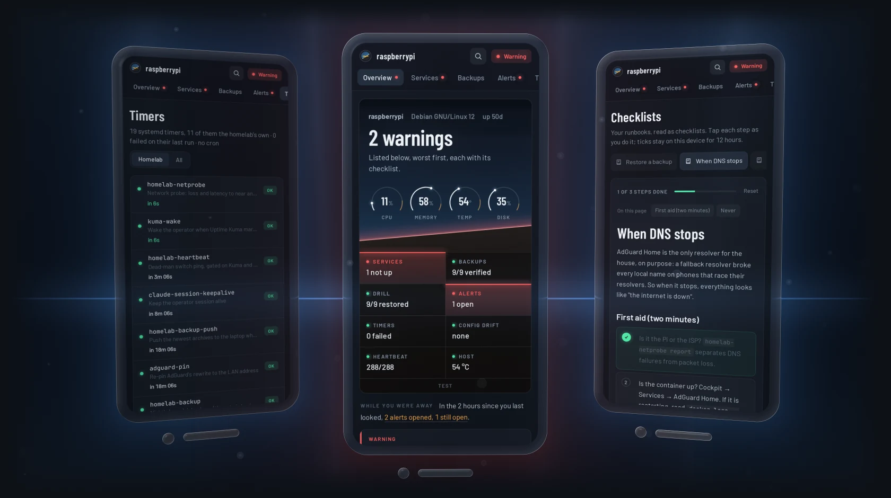</picture></a><a href="SECURITY.md#gh-light-mode-only"><picture><source media="(max-width: 767px)" srcset="docs/readme/phones-light-phone.webp 2.835x"><source srcset="docs/readme/phones-light.webp 2x">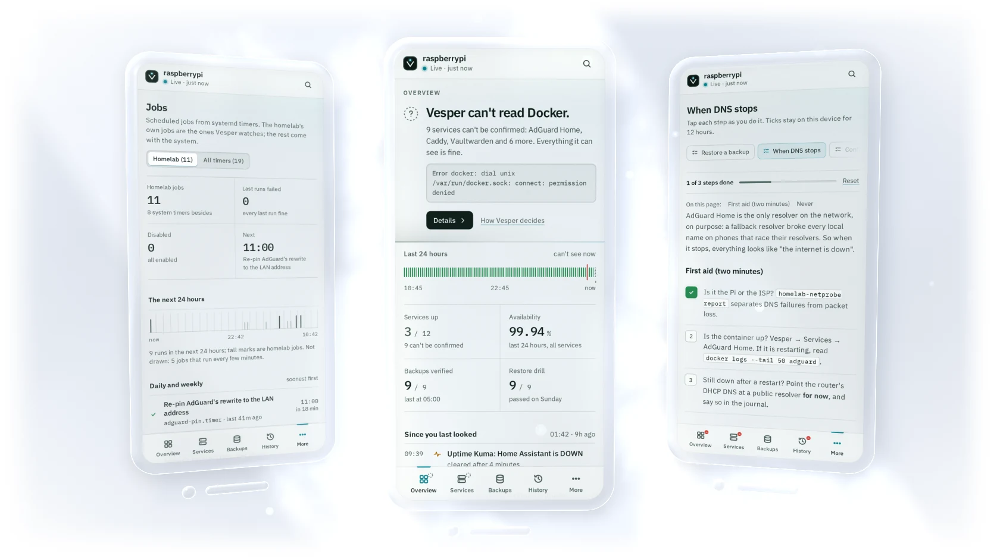</picture></a>

## Quickstart

Try it on synthetic data, with nothing to set up:

```bash
docker run --rm -p 8080:8080 ghcr.io/gallowforge/vesper       # then open http://localhost:8080
```

or with the release binary (Linux, amd64 or arm64):

```bash
curl -fsSLO https://github.com/gallowforge/vesper/releases/latest/download/vesper-linux-amd64
chmod +x vesper-linux-amd64 && ./vesper-linux-amd64 demo     # -scenario calm | attention | incident | blind
```

The image is only a demo: reading a host's journal, systemd and Docker socket from inside a container would hand that container most of the host, so on a real server the binary runs under systemd with exactly what it needs.

### Run it on your server

Vesper was built around the layout of [gallowforge/homelab](https://github.com/gallowforge/homelab) (backup status files, a notifier with keyed incidents, a `_host/MANIFEST`), and every path is configurable. Without that layout, turn the homelab part off and you still get services, probes, timers and runbooks.

```bash
sudo install -m 755 vesper-linux-arm64 /usr/local/bin/vesper
sudo install -D -m 644 deploy/vesper.conf.example /etc/vesper/vesper.conf      # then edit it (set [web] username)
sudo install -m 644 deploy/systemd/* /etc/systemd/system/
sudo install -m 644 deploy/tmpfiles.d/vesper.conf /etc/tmpfiles.d/ && sudo systemd-tmpfiles --create
vesper hash-password | sudo tee /etc/vesper/password.hash >/dev/null && sudo chmod 600 /etc/vesper/password.hash
sudo systemctl daemon-reload && sudo systemctl enable --now vesper-collect.service vesper-web.socket
vesper check -config /etc/vesper/vesper.conf                                    # the same status in a terminal
```

Then put it behind your reverse proxy: [`deploy/caddy/Caddyfile.example`](deploy/caddy/Caddyfile.example) is the whole Caddy side, and every option is in [docs/configuration.md](docs/configuration.md).

### Build from source

```bash
git clone https://github.com/gallowforge/vesper.git && cd vesper
make            # builds the UI (Node 22+), then bin/vesper with the UI inside
make test       # Go tests with the race detector, UI typecheck and tests
make e2e        # the end-to-end run under systemd (needs root, Docker)
```

## How it works

Two small processes from the same binary, with a file in RAM between them. `vesper collect` runs as root but keeps only the capability to read, and writes one snapshot, `state.json`, to `/run/vesper` every 20 seconds. `vesper serve` runs as a throwaway user with no network of its own, takes its socket from systemd and streams each new snapshot to the browser. A reverse proxy such as Caddy adds TLS in front.

<a href="deploy/systemd#gh-dark-mode-only"><picture><source media="(max-width: 767px)" srcset="docs/readme/design-dark-phone.webp 2.835x"><source srcset="docs/readme/design-dark.webp 2x"></picture></a><a href="deploy/systemd#gh-light-mode-only"><picture><source media="(max-width: 767px)" srcset="docs/readme/design-light-phone.webp 2.835x"><source srcset="docs/readme/design-light.webp 2x"></picture></a>

| Question | Method |
| --- | --- |
| How is the day counted? | Each pass marks the service's current five-minute slot with the worst state seen in it; 288 slots make the day, kept across restarts in `state.json`. A slot with no sample stays unknown, so uptime is counted only over the time Vesper actually watched. |
| How is state gathered? | A long-running collector: containers, units, probes and the host every 20 s; journal, backups, alerts, drift and runbooks every 5 min. Journal reads continue from the last cursor, so each pass reads only what is new. |
| Where do backups and drills come from? | The backup engine's per-set status files and archive directory, plus `journalctl` for each run's result and the drill's `PASS`/`FAIL` lines, grouped by invocation ID. |
| How are alerts turned into incidents? | The notifier's `sent`, `suppressed`, `resolved` and `closed` lines are grouped per key; its state directory decides what is still open, and an incident whose push has not repeated in 8 days is marked stale. |
| How is drift found? | Every `_host/MANIFEST` entry is compared with the live file (content, mode and owner), timers listed there must be enabled, and `git status --porcelain` counts uncommitted changes. |
| How is the web process isolated? | Socket activation, `DynamicUser`, `PrivateNetwork=yes`, no capabilities and a strict system-call filter; the password hash arrives as a `LoadCredential`. |
| How is a login protected? | A username compared in constant time and a PBKDF2-SHA256 hash with 600,000 rounds; a wrong username gets the same answer, delay and back-off as a wrong password. Then an HMAC-signed `HttpOnly`, `SameSite=Strict` cookie, one password check at a time, and back-off after 5 failures. |
| How are log lines and runbooks kept safe to show? | A redactor drops URL paths and credentials, `key=value` and `--password` secrets, bearer and basic tokens, JWTs, AWS keys, UUIDs and long hex or base64 runs. Runbook HTML is escaped, only `http`, `https`, `mailto` and relative links survive, and a strict Content-Security-Policy forbids inline script. |

## Quality

Every push runs [`ci.yml`](.github/workflows/ci.yml), and each step also runs on a workstation.

| Check | What it covers |
| --- | --- |
| `go test -race` | 58 tests: config parsing, journal and notifier parsing, incidents, the status rollup and its blind spots, the day line, the redactor, the collector on a synthetic homelab with stubbed `systemctl` and `journalctl`, login, sessions, parallel login bursts, rate limits and the event stream |
| `vitest` and `tsc` | 75 tests: the day line and uptime, the status and its facts, formatting, grouping, jobs, null-safe and older snapshots, the ribbon's arithmetic (whose thread is whose, and where it lies), the collector's log lines, the command bar's search, Markdown escaping and link filtering, and a login form filled the way a password manager fills it |
| [`scripts/e2e.sh`](scripts/e2e.sh) | 34 checks: the shipped units under real systemd with their sandbox, the day line written for every service, transient units writing real journal entries, real Docker containers, and Caddy in front for TLS, cookies and streaming |
| `systemd-analyze verify` and `security` | The unit files are valid; exposure 2.4 for the collector and 0.5 for the web process |
| `gofmt`, `go vet`, `shellcheck` | Formatting and static checks |
| gitleaks | The full history, on every push |

<a href="scripts/e2e.sh#gh-dark-mode-only"><picture><source media="(max-width: 767px)" srcset="docs/readme/proof-dark-phone.webp 2.835x"><source srcset="docs/readme/proof-dark.webp 2x"></picture></a><a href="scripts/e2e.sh#gh-light-mode-only"><picture><source media="(max-width: 767px)" srcset="docs/readme/proof-light-phone.webp 2.835x"><source srcset="docs/readme/proof-light.webp 2x"></picture></a>

## FAQ

<details>
<summary><b>Why is it called Vesper?</b></summary>
<br />
Vesper is the evening star, the first light that appears when night falls: the one you look up at when everything has gone quiet. Until version 2.0 it was called Cockpit; the new name also keeps it clear of the unrelated Cockpit Project, a server console that can change the system. A config file with the old <code>[cockpit]</code> section still works.
</details>

<details>
<summary><b>Can it restart a service or run a backup?</b></summary>
<br />
No, on purpose. The web process has no network, no capabilities and no write access, and the collector only reads. A dashboard you open on your phone should not be able to break the server; the checklists tell you what to run.
</details>

<details>
<summary><b>Why not Prometheus and Grafana?</b></summary>
<br />
They are the right tools for metrics over time. Vesper answers a different question, "is everything fine, and if not, what do I do?", from facts that are not metrics: which backup set was verified, which drill line failed, which alert never got its all-clear, which config file drifted. It needs no database and fits in 27 MB.
</details>

<details>
<summary><b>Do I need the gallowforge/homelab layout?</b></summary>
<br />
No. Services, probes, timers, host health and runbooks work on any Linux host with systemd. The backup, drill, alert and drift views read that layout's files, and every path is configurable in <code>[homelab]</code>; set <code>enabled = false</code> to turn them off.
</details>

<details>
<summary><b>Why does the collector run as root?</b></summary>
<br />
Because the journal, the Docker socket and the backup state are root's. It keeps only <code>CAP_DAC_READ_SEARCH</code>, cannot write outside <code>/run/vesper</code>, has no listening socket and cannot reach the internet. Everything that talks to a browser runs in the other, unprivileged process.
</details>

## Contributing

Issues and pull requests are welcome, especially a new source (another backup tool's status, another notifier) or a check that would have caught a real problem earlier; run `make test` first, and keep demo data obviously fake. The README images come from [`scripts/readme-visuals.sh`](scripts/readme-visuals.sh), which captures `vesper demo` and renders it as glass.

## Licence

[MIT](LICENSE). Built by Ali Husain.
