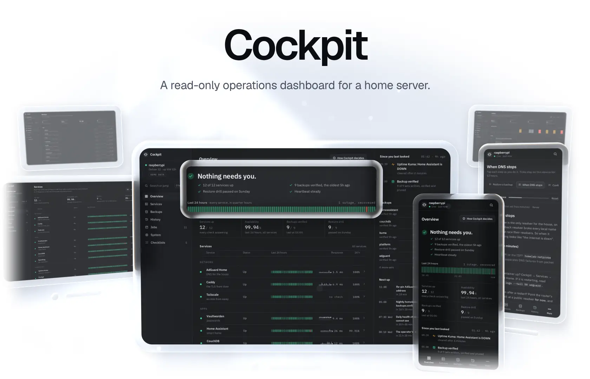
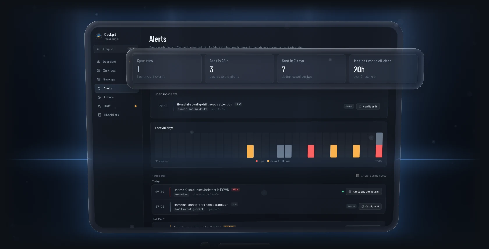
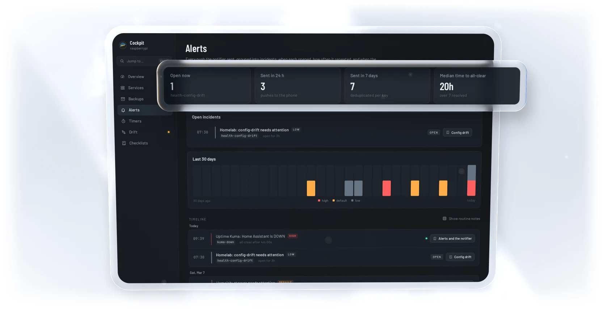

<a href="https://github.com/gallowforge/cockpit/releases/latest#gh-dark-mode-only"><picture><source media="(max-width: 767px)" srcset="docs/readme/hero-dark-phone.webp 2.835x"><source srcset="docs/readme/hero-dark.webp 2x"></picture></a><a href="https://github.com/gallowforge/cockpit/releases/latest#gh-light-mode-only"><picture><source media="(max-width: 767px)" srcset="docs/readme/hero-light-phone.webp 2.835x"><source srcset="docs/readme/hero-light.webp 2x"></picture></a>

A well-run homelab already knows a lot about itself: the backup job records what it verified, a weekly drill restores the archives, a notifier remembers every alert, and a repo says what every config file should contain. Cockpit reads all of it, adds live service health seen from the client's side, and shows the answer on one calm page for a phone or a desktop. While the horizon is level and blue, nothing needs you; when something does, it banks amber or red and names it, worst first, with its checklist. It only reads, and it is one binary with the UI inside.

<p align="center"><a href="#quickstart"><b>Quickstart</b></a> &nbsp;·&nbsp; <a href="#how-it-works">How it works</a> &nbsp;·&nbsp; <a href="https://github.com/gallowforge/cockpit/releases">Releases</a></p>

<a href="docs/configuration.md#gh-dark-mode-only"><picture><source media="(max-width: 767px)" srcset="docs/readme/numbers-dark-phone.webp 2.835x"><source srcset="docs/readme/numbers-dark.webp 2x"></picture></a><a href="docs/configuration.md#gh-light-mode-only"><picture><source media="(max-width: 767px)" srcset="docs/readme/numbers-light-phone.webp 2.835x"><source srcset="docs/readme/numbers-light.webp 2x"></picture></a>

<sub>7.4 MB is the static arm64 binary on the releases page. RAM was measured on a Raspberry Pi 5 watching 22 services, 12 backup sets and 29 timers, at 0.8% of one CPU core. Every screen in these images is the real UI of <code>cockpit demo</code> on synthetic data and a frozen clock.</sub>

## Know in one glance if the house is fine

One horizon and one headline: level and blue with "All systems normal", or banked amber or red with every problem listed worst first, each linked to the checklist that covers it. Eight lamps stay dark until one needs you, and after a night away one line tells you what happened while you were gone. New snapshots arrive over Server-Sent Events, so the page is live without a refresh.

<a href="docs/configuration.md#gh-dark-mode-only"><picture><source media="(max-width: 767px)" srcset="docs/readme/overview-dark-phone.webp 2.835x"><source srcset="docs/readme/overview-dark.webp 2x"></picture></a><a href="docs/configuration.md#gh-light-mode-only"><picture><source media="(max-width: 767px)" srcset="docs/readme/overview-light-phone.webp 2.835x"><source srcset="docs/readme/overview-light.webp 2x"></picture></a>

## Every service, seen the way a client sees it

A service joins a Docker container, a systemd unit and a probe that goes through your reverse proxy with the right TLS name, so an expiring certificate or a broken route shows up. Each row keeps a heartbeat bar, latency, uptime, restarts and the days left on its certificate. Press <kbd>Ctrl</kbd> <kbd>K</kbd> and type three letters to land on any service, backup set, alert, timer or checklist.

<a href="docs/configuration.md#gh-dark-mode-only"><picture><source media="(max-width: 767px)" srcset="docs/readme/services-dark-phone.webp 2.835x"><source srcset="docs/readme/services-dark.webp 2x"></picture></a><a href="docs/configuration.md#gh-light-mode-only"><picture><source media="(max-width: 767px)" srcset="docs/readme/services-light-phone.webp 2.835x"><source srcset="docs/readme/services-light.webp 2x"></picture></a>

## Backups you can trust, with the proof beside them

Each set shows when it was last verified, its age against its own limit, its size and the row counts the backup engine checked. Thirty nights of runs come from the journal, with the line that explains a failed one, and the weekly restore drill's PASS and FAIL lines sit beside them, so you know the archive you would restore from has already been read back.

<a href="https://github.com/gallowforge/homelab#gh-dark-mode-only"><picture><source media="(max-width: 767px)" srcset="docs/readme/backups-dark-phone.webp 2.835x"><source srcset="docs/readme/backups-dark.webp 2x"></picture></a><a href="https://github.com/gallowforge/homelab#gh-light-mode-only"><picture><source media="(max-width: 767px)" srcset="docs/readme/backups-light-phone.webp 2.835x"><source srcset="docs/readme/backups-light.webp 2x"></picture></a>

## Every alert, as one timeline

Each push from the notifier is grouped with its repeats and its all-clear, so you read "open for 3 hours" or "all-clear after 4 minutes" instead of a phone full of separate pushes. What is open right now comes from the notifier's own state, so an alert that was never resolved cannot quietly disappear, and 30 days of pushes are charted by severity.

<a href="docs/configuration.md#gh-dark-mode-only"><picture><source media="(max-width: 767px)" srcset="docs/readme/alerts-dark-phone.webp 2.835x"><source srcset="docs/readme/alerts-dark.webp 2x"></picture></a><a href="docs/configuration.md#gh-light-mode-only"><picture><source media="(max-width: 767px)" srcset="docs/readme/alerts-light-phone.webp 2.835x"><source srcset="docs/readme/alerts-light.webp 2x"></picture></a>

## Made for the phone in your hand

Every page works on a phone, and Cockpit installs to the home screen as an app. Point it at the Markdown runbooks you already keep and their numbered steps become a checklist you tick through, kept on that device for 12 hours. Sign-in is one username-and-password form that password managers save and fill, checked against a PBKDF2 hash with 600,000 rounds.

<a href="SECURITY.md#gh-dark-mode-only"><picture><source media="(max-width: 767px)" srcset="docs/readme/phones-dark-phone.webp 2.835x"><source srcset="docs/readme/phones-dark.webp 2x"></picture></a><a href="SECURITY.md#gh-light-mode-only"><picture><source media="(max-width: 767px)" srcset="docs/readme/phones-light-phone.webp 2.835x"><source srcset="docs/readme/phones-light.webp 2x"></picture></a>

## Quickstart

Try it on synthetic data, with nothing to set up:

```bash
docker run --rm -p 8080:8080 ghcr.io/gallowforge/cockpit       # then open http://localhost:8080
```

or with the release binary (Linux, amd64 or arm64):

```bash
curl -fsSLO https://github.com/gallowforge/cockpit/releases/latest/download/cockpit-linux-amd64
chmod +x cockpit-linux-amd64 && ./cockpit-linux-amd64 demo     # -scenario calm | attention | incident
```

The image is only a demo: reading a host's journal, systemd and Docker socket from inside a container would hand that container most of the host, so on a real server the binary runs under systemd with exactly what it needs.

### Run it on your server

Cockpit was built around the layout of [gallowforge/homelab](https://github.com/gallowforge/homelab) (backup status files, a notifier with keyed incidents, a `_host/MANIFEST`), and every path is configurable. Without that layout, turn the homelab part off and you still get services, probes, timers and runbooks.

```bash
sudo install -m 755 cockpit-linux-arm64 /usr/local/bin/cockpit
sudo install -D -m 644 deploy/cockpit.conf.example /etc/cockpit/cockpit.conf      # then edit it (set [web] username)
sudo install -m 644 deploy/systemd/* /etc/systemd/system/
sudo install -m 644 deploy/tmpfiles.d/cockpit.conf /etc/tmpfiles.d/ && sudo systemd-tmpfiles --create
cockpit hash-password | sudo tee /etc/cockpit/password.hash >/dev/null && sudo chmod 600 /etc/cockpit/password.hash
sudo systemctl daemon-reload && sudo systemctl enable --now cockpit-collect.service cockpit-web.socket
cockpit check -config /etc/cockpit/cockpit.conf                                    # the same status in a terminal
```

Then put it behind your reverse proxy: [`deploy/caddy/Caddyfile.example`](deploy/caddy/Caddyfile.example) is the whole Caddy side, and every option is in [docs/configuration.md](docs/configuration.md).

### Build from source

```bash
git clone https://github.com/gallowforge/cockpit.git && cd cockpit
make            # builds the UI (Node 22+), then bin/cockpit with the UI inside
make test       # Go tests with the race detector, UI typecheck and tests
make e2e        # the end-to-end run under systemd (needs root, Docker)
```

## How it works

Two small processes from the same binary, with a file in RAM between them. `cockpit collect` runs as root but keeps only the capability to read, and writes one snapshot, `state.json`, to `/run/cockpit` every 20 seconds. `cockpit serve` runs as a throwaway user with no network of its own, takes its socket from systemd and streams each new snapshot to the browser. A reverse proxy such as Caddy adds TLS in front.

<a href="deploy/systemd#gh-dark-mode-only"><picture><source media="(max-width: 767px)" srcset="docs/readme/design-dark-phone.webp 2.835x"><source srcset="docs/readme/design-dark.webp 2x"></picture></a><a href="deploy/systemd#gh-light-mode-only"><picture><source media="(max-width: 767px)" srcset="docs/readme/design-light-phone.webp 2.835x"><source srcset="docs/readme/design-light.webp 2x"></picture></a>

| Question | Method |
| --- | --- |
| How is state gathered? | A long-running collector: containers, units, probes and the host every 20 s; journal, backups, alerts, drift and runbooks every 5 min. Journal reads continue from the last cursor, so each pass reads only what is new. |
| Where do backups and drills come from? | The backup engine's per-set status files and archive directory, plus `journalctl` for each run's result and the drill's `PASS`/`FAIL` lines, grouped by invocation ID. |
| How are alerts turned into incidents? | The notifier's `sent`, `suppressed`, `resolved` and `closed` lines are grouped per key; its state directory decides what is still open, and an incident whose push has not repeated in 8 days is marked stale. |
| How is drift found? | Every `_host/MANIFEST` entry is compared with the live file (content, mode and owner), timers listed there must be enabled, and `git status --porcelain` counts uncommitted changes. |
| How is the web process isolated? | Socket activation, `DynamicUser`, `PrivateNetwork=yes`, no capabilities and a strict system-call filter; the password hash arrives as a `LoadCredential`. |
| How is a login protected? | A username compared in constant time and a PBKDF2-SHA256 hash with 600,000 rounds; a wrong username gets the same answer, delay and back-off as a wrong password. Then an HMAC-signed `HttpOnly`, `SameSite=Strict` cookie, one password check at a time, and back-off after 5 failures. |
| How are log lines and runbooks kept safe to show? | A redactor drops URL paths and credentials, `key=value` and `--password` secrets, bearer and basic tokens, JWTs, AWS keys, UUIDs and long hex or base64 runs. Runbook HTML is escaped, only `http`, `https`, `mailto` and relative links survive, and a strict Content-Security-Policy forbids inline script. |

## Quality

Every push runs [`ci.yml`](.github/workflows/ci.yml), and each step also runs on a workstation.

| Check | What it covers |
| --- | --- |
| `go test -race` | 47 tests: config parsing, journal and notifier parsing, incidents, the status rollup, the redactor, the collector on a synthetic homelab with stubbed `systemctl` and `journalctl`, login, sessions, parallel login bursts, rate limits and the event stream |
| `vitest` and `tsc` | 33 tests: formatting, grouping, timers, null-safe snapshots, the command bar's search, the while-you-were-away line, Markdown escaping and link filtering, and a login form filled the way a password manager fills it |
| [`scripts/e2e.sh`](scripts/e2e.sh) | 33 checks: the shipped units under real systemd with their sandbox, transient units writing real journal entries, real Docker containers, and Caddy in front for TLS, cookies and streaming |
| `systemd-analyze verify` and `security` | The unit files are valid; exposure 2.4 for the collector and 0.5 for the web process |
| `gofmt`, `go vet`, `shellcheck` | Formatting and static checks |
| gitleaks | The full history, on every push |

<a href="scripts/e2e.sh#gh-dark-mode-only"><picture><source media="(max-width: 767px)" srcset="docs/readme/proof-dark-phone.webp 2.835x"><source srcset="docs/readme/proof-dark.webp 2x"></picture></a><a href="scripts/e2e.sh#gh-light-mode-only"><picture><source media="(max-width: 767px)" srcset="docs/readme/proof-light-phone.webp 2.835x"><source srcset="docs/readme/proof-light.webp 2x"></picture></a>

## FAQ

<details>
<summary><b>Is this the Cockpit web console from the Cockpit Project?</b></summary>
<br />
No, and it is not related to it. The <a href="https://cockpit-project.org">Cockpit Project</a> is a server admin console that can change the system. This Cockpit is a read-only dashboard for the state a homelab's own scripts write.
</details>

<details>
<summary><b>Can it restart a service or run a backup?</b></summary>
<br />
No, on purpose. The web process has no network, no capabilities and no write access, and the collector only reads. A dashboard you open on your phone on the sofa should not be able to break the house; the checklists tell you what to run.
</details>

<details>
<summary><b>Why not Prometheus and Grafana?</b></summary>
<br />
They are the right tools for metrics over time. Cockpit answers a different question, "is everything fine, and if not, what do I do?", from facts that are not metrics: which backup set was verified, which drill line failed, which alert never got its all-clear, which config file drifted. It needs no database and fits in 27 MB.
</details>

<details>
<summary><b>Do I need the gallowforge/homelab layout?</b></summary>
<br />
No. Services, probes, timers, host health and runbooks work on any Linux host with systemd. The backup, drill, alert and drift views read that layout's files, and every path is configurable in <code>[homelab]</code>; set <code>enabled = false</code> to turn them off.
</details>

<details>
<summary><b>Why does the collector run as root?</b></summary>
<br />
Because the journal, the Docker socket and the backup state are root's. It keeps only <code>CAP_DAC_READ_SEARCH</code>, cannot write outside <code>/run/cockpit</code>, has no listening socket and cannot reach the internet. Everything that talks to a browser runs in the other, unprivileged process.
</details>

## Contributing

Issues and pull requests are welcome, especially a new source (another backup tool's status, another notifier) or a check that would have caught a real problem earlier; run `make test` first, and keep demo data obviously fake. The README images come from [`scripts/readme-visuals.sh`](scripts/readme-visuals.sh), which captures `cockpit demo` and renders it as glass.

## Licence

[MIT](LICENSE). Built by Ali Husain.
