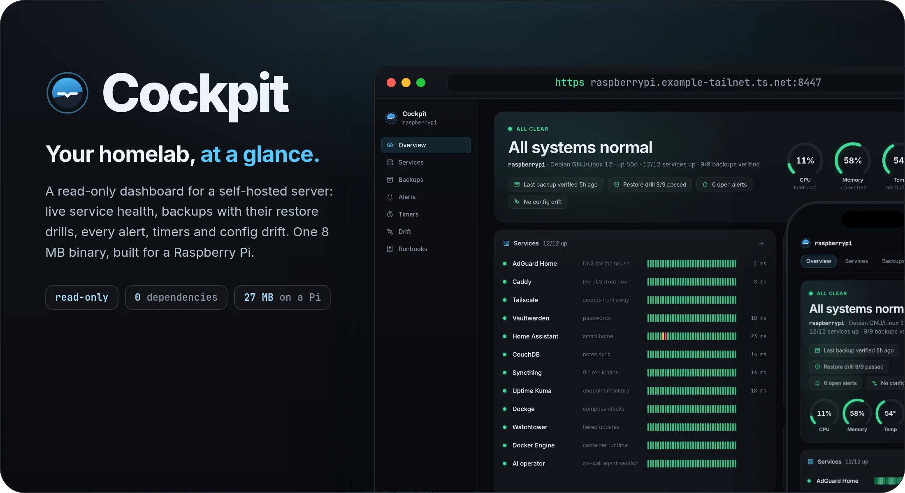
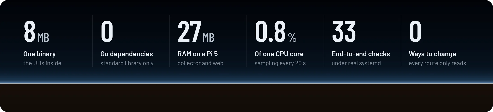
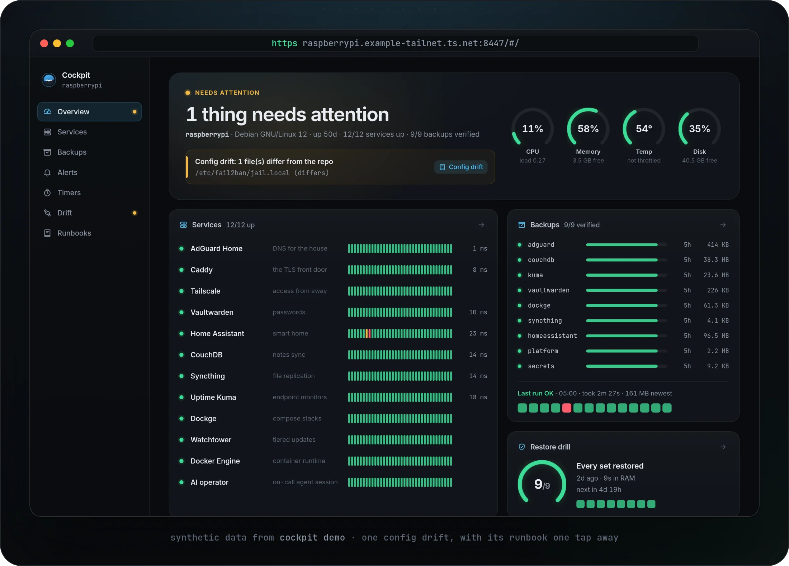
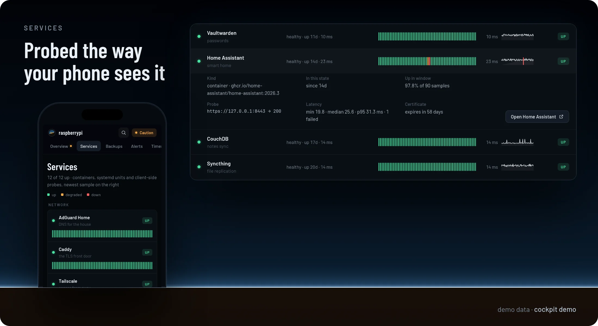
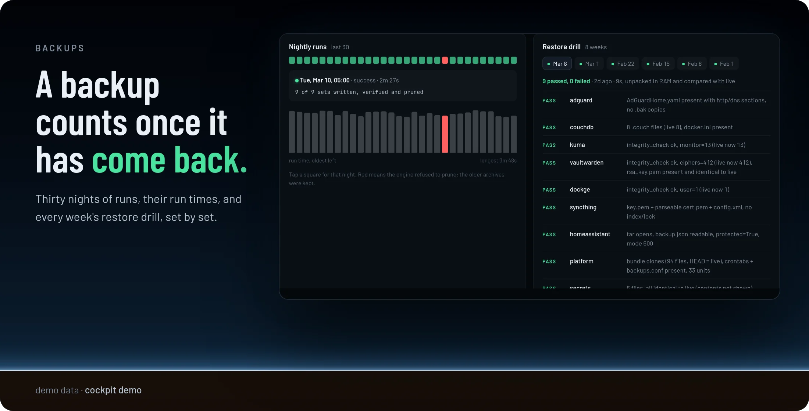
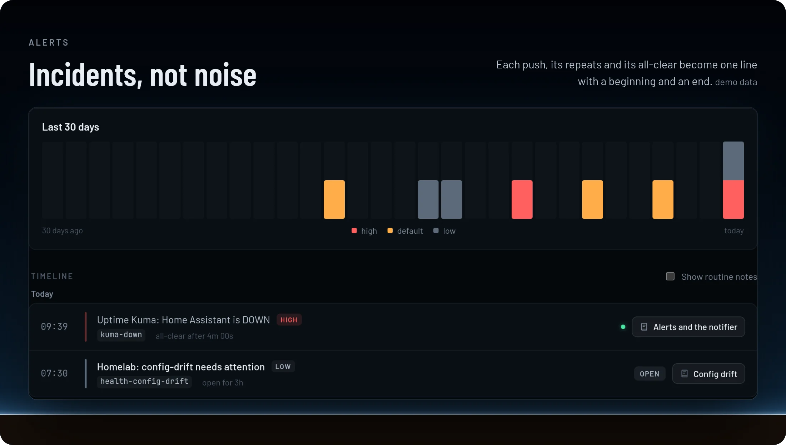
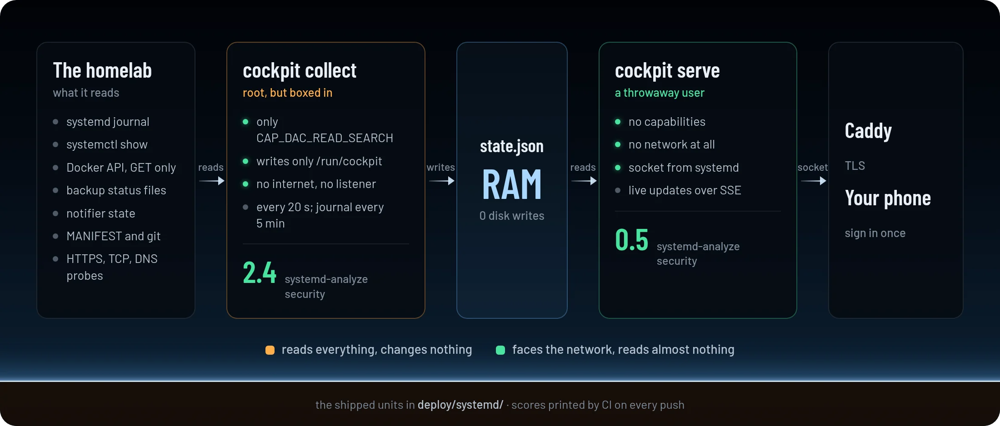
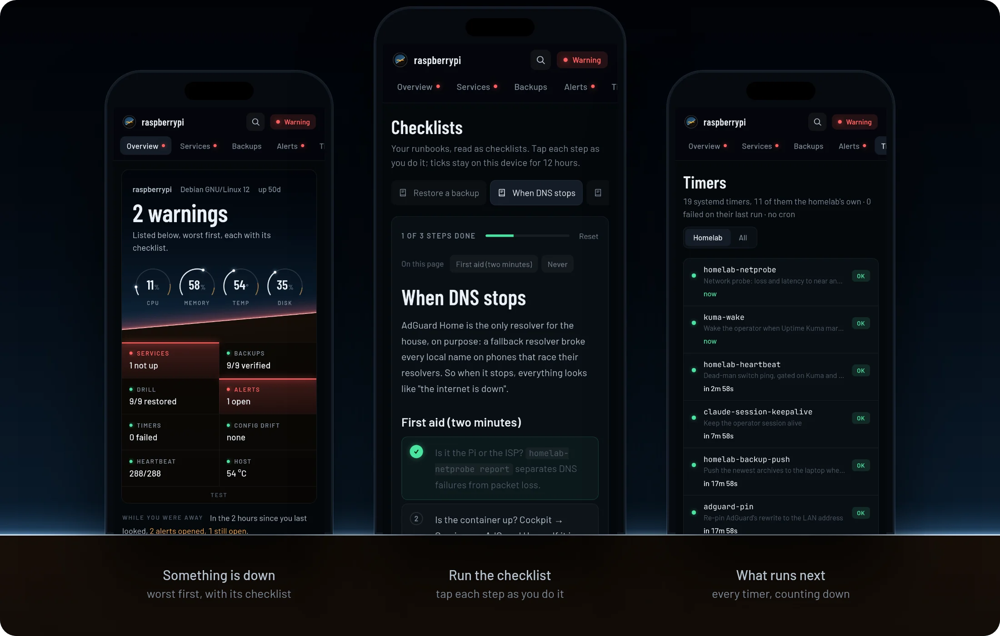
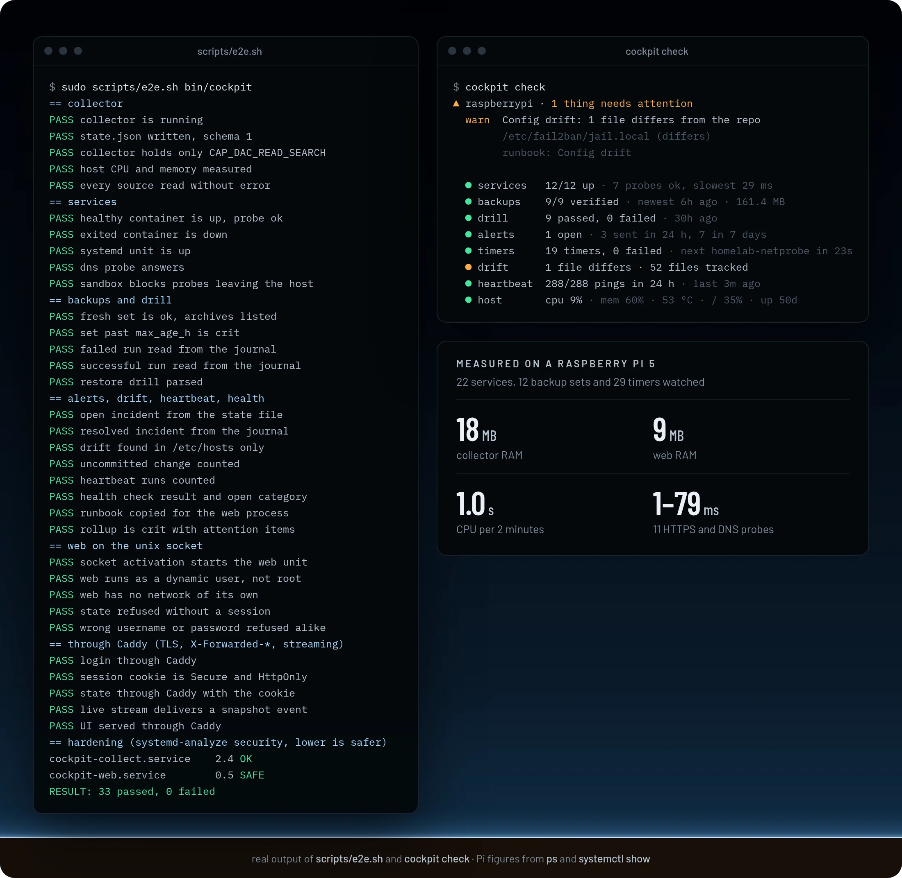

<picture>
  <source media="(max-width: 700px)" srcset="docs/readme/hero-mobile.webp" />
  
</picture>

<p align="center">
  <a href="#quickstart"><b>Quickstart</b></a>
  &nbsp;·&nbsp;
  <a href="#how-it-works">How it works</a>
  &nbsp;·&nbsp;
  <a href="docs/configuration.md">Configuration</a>
  &nbsp;·&nbsp;
  <a href="SECURITY.md">Security</a>
  &nbsp;·&nbsp;
  <a href="CHANGELOG.md">Changelog</a>
</p>

<p align="center">
  <a href="https://github.com/gallowforge/cockpit/actions/workflows/ci.yml"></a>
  
  
  
  <a href="LICENSE"></a>
</p>

<br />

A well-run homelab already knows a lot about itself. The backup job writes what it verified, a weekly drill restores the archives, a notifier remembers every alert, systemd runs the timers, and a repo says what every config file should contain. But each of those answers lives in a different log or state file, so checking "is the house OK?" means five commands over SSH, and a problem waits until somebody looks.

**Cockpit puts all of it on one page.** It reads the state your scripts already write, adds live service health from the client's side, and shows the result as one calm dashboard on a phone or a desktop. It only reads: there is no button that changes anything. It is one 8 MB binary with the UI inside, and it runs on a Raspberry Pi with room to spare.

<picture>
  <source media="(max-width: 700px)" srcset="docs/readme/numbers-mobile.webp" />
  
</picture>

<sub>RAM and CPU measured on a Raspberry Pi 5 watching 22 services, 12 backup sets and 29 timers. The binary size is the static arm64 build.</sub>

<br />

## How it works

Two small processes from the same binary, with a file in RAM between them. `cockpit collect` runs as root but keeps only the capability to read, and writes one snapshot, `state.json`, to `/run/cockpit` every 20 seconds. `cockpit serve` runs as a throwaway user with no network of its own, serves the UI and streams each new snapshot to the browser. A reverse proxy such as Caddy adds TLS in front. The [full picture](#read-only-by-construction) is further down.

## Know in one glance if the house is fine

- **One headline.** "All systems normal", or "2 things need attention" with each thing listed worst first: a stopped container, a stale backup, a failed run, an open alert, config drift, a withheld heartbeat.
- **The fix is one tap away.** Every problem links to the runbook that covers it, matched by alert key, service or area.
- **Live, without refreshing.** New snapshots arrive over Server-Sent Events as soon as the collector writes them; if the stream drops, the page falls back to polling and says so.
- **The host at a glance.** CPU, memory, temperature and disk as instrument dials, plus the Raspberry Pi's throttle flags.

<picture>
  <source media="(max-width: 700px)" srcset="docs/readme/overview-mobile.webp" />
  
</picture>

## Every service, seen the way a client sees it

- **Containers, units and probes in one row.** A service can join a Docker container, a systemd unit and a probe. Containers you did not list still appear under their own name.
- **Probes go through the real path.** HTTPS through your reverse proxy with the right TLS name, so an expiring certificate or a broken route shows up; also plain TCP and DNS lookups.
- **History you can read.** A heartbeat bar per service, a latency sparkline, uptime over the window, restart counts and days left on the certificate.

<picture>
  <source media="(max-width: 700px)" srcset="docs/readme/services-mobile.webp" />
  
</picture>

## Backups you can trust, with the proof beside them

- **Every set, fresh or not.** When each set was last verified, its age against its own limit, its size, the archives still kept and the row counts the backup engine checked.
- **Every night, every run.** Thirty nights of results and run times read from the journal; a failed run shows the line that explains it.
- **The restore drill, set by set.** The weekly drill's PASS and FAIL lines, week by week, so you know the archive you would restore from has already been read back.

<picture>
  <source media="(max-width: 700px)" srcset="docs/readme/backups-mobile.webp" />
  
</picture>

## Every alert, as one timeline

- **Incidents, not noise.** Each push from the notifier is grouped with its repeats and its all-clear, so you see "open for 3 hours" or "all-clear after 4 minutes", and how many repeats were held back.
- **What is open right now** comes from the notifier's own state, so an alert that was never resolved cannot quietly disappear.
- **Trends.** Pushes per day for 30 days by severity, and the median time to all-clear.

<picture>
  <source media="(max-width: 700px)" srcset="docs/readme/alerts-mobile.webp" />
  
</picture>

<a name="read-only-by-construction"></a>
## Read-only by construction

- **The reader cannot write; the writer cannot read.** The collector sees everything but holds only `CAP_DAC_READ_SEARCH`, may write nowhere except `/run/cockpit`, and has no listening socket. The web process faces the network but runs as a throwaway user with no capabilities and no network at all: systemd hands it the socket.
- **Nothing leaves the house.** The collector's probes may reach the host and its container networks, never the internet (`IPAddressDeny`), and Docker is only ever asked with `GET`.
- **No disk writes.** The snapshot lives in RAM, and errors are logged once when they start and once when they clear, which matters on a Pi that boots from a flash stick.
- **Measured, not claimed.** `systemd-analyze security` rates the shipped units 2.4 (OK) and 0.5 (SAFE); CI runs both under real systemd on every push.

<picture>
  <source media="(max-width: 700px)" srcset="docs/readme/sandbox-mobile.webp" />
  
</picture>

## Made for the phone in your hand

- **Every page works on a phone,** from the attention list to the drill results, and the browser tab title shows the status while it sits in the background.
- **Your own runbooks, rendered.** Point Cockpit at the Markdown files you already keep; it renders them with raw HTML escaped and unsafe links removed, and shows a short outline of each.
- **Sign in once.** A password (PBKDF2, 600,000 rounds) and a signed session cookie that lasts a year; logins are rate-limited per client and in total.

<picture>
  <source media="(max-width: 700px)" srcset="docs/readme/phones-mobile.webp" />
  
</picture>

## Why it is different

|                    | Cockpit                                                    | The usual way                                  |
| ------------------ | ---------------------------------------------------------- | ---------------------------------------------- |
| Backups            | Verified sets, nightly runs and restore drills on one page | A log file, if anyone reads it                 |
| Alerts             | Incidents with duration and all-clear, from the notifier   | A phone full of separate pushes                |
| Health             | Containers, units and client-side probes together          | One tool per layer                             |
| Config drift       | The repo compared with the live host, byte for byte        | Found when something breaks                    |
| What it can do     | Read                                                       | Admin panels that can also stop things         |
| Footprint          | One binary, 27 MB of RAM, no database                      | A metrics stack with its own storage           |
| Answer when it breaks | A runbook link on the problem itself                    | Searching the wiki                             |

## Quickstart

Try it on synthetic data, with nothing to set up:

```bash
docker run --rm -p 8080:8080 ghcr.io/gallowforge/cockpit       # then open http://localhost:8080
```

or with the release binary (Linux, amd64 or arm64):

```bash
curl -fsSLO https://github.com/gallowforge/cockpit/releases/latest/download/cockpit-linux-amd64
chmod +x cockpit-linux-amd64 && ./cockpit-linux-amd64 demo     # -scenario calm | attention | incident
```

### Run it on your server

Cockpit was built around the layout of [gallowforge/homelab](https://github.com/gallowforge/homelab) (backup status files, a notifier with keyed incidents, a `_host/MANIFEST`), and every path is configurable. Without that layout, turn the homelab part off and you still get services, probes, timers and runbooks.

```bash
sudo install -m 755 cockpit-linux-arm64 /usr/local/bin/cockpit
sudo install -D -m 644 deploy/cockpit.conf.example /etc/cockpit/cockpit.conf      # then edit it
sudo install -m 644 deploy/systemd/* /etc/systemd/system/
sudo install -m 644 deploy/tmpfiles.d/cockpit.conf /etc/tmpfiles.d/ && sudo systemd-tmpfiles --create
cockpit hash-password | sudo tee /etc/cockpit/password.hash >/dev/null && sudo chmod 600 /etc/cockpit/password.hash
sudo systemctl daemon-reload && sudo systemctl enable --now cockpit-collect.service cockpit-web.socket
cockpit check -config /etc/cockpit/cockpit.conf                                    # the same status in a terminal
```

Then put it behind your reverse proxy: [`deploy/caddy/Caddyfile.example`](deploy/caddy/Caddyfile.example) is the whole Caddy side. Every option is in [docs/configuration.md](docs/configuration.md).

### Build from source

```bash
git clone https://github.com/gallowforge/cockpit.git && cd cockpit
make            # builds the UI (Node 22+), then bin/cockpit with the UI inside
make test       # Go tests with the race detector, UI typecheck and tests
make e2e        # the end-to-end run under systemd (needs root, Docker)
```

## Under the hood

| Question | Method |
| --- | --- |
| How is state gathered? | A long-running collector: containers, units, probes and the host every 20 s; journal, backups, alerts, drift and runbooks every 5 min. Journal reads continue from the last cursor, so each pass reads only what is new. |
| Where do backups and drills come from? | The backup engine's per-set status files and archive directory, plus `journalctl` for each run's result and the drill's `PASS`/`FAIL` lines, grouped by invocation ID. |
| How are alerts turned into incidents? | The notifier's log lines (`sent`, `suppressed`, `resolved`, `closed`) are grouped per key; its state directory decides what is still open, and an incident whose push has not repeated in 8 days is marked stale. |
| How is drift found? | Every `_host/MANIFEST` entry is compared with the live file: content, mode and owner. Timers listed there must be enabled, and `git status --porcelain` counts uncommitted changes. |
| How does the page stay live? | The web process watches `state.json` (one `stat` a second) and pushes each new version over Server-Sent Events, with a comment every 20 s for proxies. |
| How is the web process isolated? | systemd socket activation, `DynamicUser`, `PrivateNetwork=yes`, no capabilities, a strict system-call filter; the password hash arrives as a `LoadCredential`. |
| How is a login protected? | PBKDF2-SHA256 with 600,000 rounds, an HMAC-signed cookie (`HttpOnly`, `SameSite=Strict`, `Secure` behind TLS), JSON-only same-origin logins, and back-off after 5 failures. |
| How are log lines kept safe to show? | Titles and summaries pass a redactor that drops URL paths, `key=value` secrets, bearer tokens, UUIDs and long hex or base64 runs. |
| How do runbooks stay safe to render? | Raw HTML is escaped, only `http`, `https`, `mailto` and relative links survive, images become their alt text, and a strict Content-Security-Policy forbids inline script. |

## Quality

Every push runs [`ci.yml`](.github/workflows/ci.yml), and each step also runs on a workstation.

| Check | What it covers |
| --- | --- |
| `go test -race` | 43 tests: config parsing and validation, journal and notifier parsing, incident building, the status rollup, the collector on a synthetic homelab with stubbed `systemctl` and `journalctl`, login, sessions, rate limits, the event stream |
| `vitest` and `tsc` | 21 tests: formatting, grouping, timers, the server clock, null-safe snapshots, Markdown escaping and link filtering |
| [`scripts/e2e.sh`](scripts/e2e.sh) | 33 checks: the shipped units under real systemd with their sandbox, transient units writing real journal entries, real Docker containers, and Caddy in front for TLS, cookies and streaming |
| `systemd-analyze verify` and `security` | The unit files are valid; exposure 2.4 for the collector, 0.5 for the web process |
| `gofmt`, `go vet`, `shellcheck` | Formatting and static checks |
| gitleaks | The full history, on every push |

<picture>
  <source media="(max-width: 700px)" srcset="docs/readme/proof-mobile.webp" />
  
</picture>

## FAQ

<details>
<summary><b>Is this the Cockpit web console from the Cockpit Project?</b></summary>
<br />
No, and it is not related to it. The <a href="https://cockpit-project.org">Cockpit Project</a> is a server admin console that can change the system. This Cockpit is a read-only dashboard for the state a homelab's own scripts write.
</details>

<details>
<summary><b>Can it restart a service or run a backup?</b></summary>
<br />
No, on purpose. The web process has no network, no capabilities and no write access, and the collector only reads. A dashboard you open on your phone on the sofa should not be able to break the house. The runbooks tell you what to run.
</details>

<details>
<summary><b>Why not Prometheus and Grafana?</b></summary>
<br />
They are the right tools for metrics over time. Cockpit answers a different question, "is everything fine, and if not, what do I do?", from facts that are not metrics: which backup set was verified, which drill line failed, which alert never got its all-clear, which config file drifted. It needs no database and fits in 27 MB.
</details>

<details>
<summary><b>Do I need the gallowforge/homelab layout?</b></summary>
<br />
No. Services, probes, timers, host health and runbooks work on any Linux host with systemd. The backup, drill, alert and drift views read that layout's files, and every path is configurable in <code>[homelab]</code>; set <code>enabled = false</code> to turn them off.
</details>

<details>
<summary><b>Why does the collector run as root?</b></summary>
<br />
Because the journal, the Docker socket and the backup state are root's. It keeps only <code>CAP_DAC_READ_SEARCH</code>, cannot write outside <code>/run/cockpit</code>, has no listening socket and cannot reach the internet. Everything that talks to a browser runs in the other, unprivileged process.
</details>

<details>
<summary><b>Why is the Docker image only a demo?</b></summary>
<br />
Reading a host's journal, systemd and Docker socket from inside a container means handing that container most of the host. Running the binary under systemd gives it exactly what it needs and nothing more, so that is the supported way.
</details>

## Contributing

Issues and pull requests are welcome, especially a new source (another backup tool's status, another notifier) or a check that would have caught a real problem earlier. Run `make test` before opening one; CI also runs the end-to-end script. Demo data must stay obviously fake: `example-tailnet.ts.net`, placeholder hosts, no real addresses.

The README images come from [`scripts/readme-visuals.sh`](scripts/readme-visuals.sh): it screenshots `cockpit demo` on a frozen clock and renders the pages in `docs/readme/src/`.

## Licence

[MIT](LICENSE). Built by Ali Husain.
